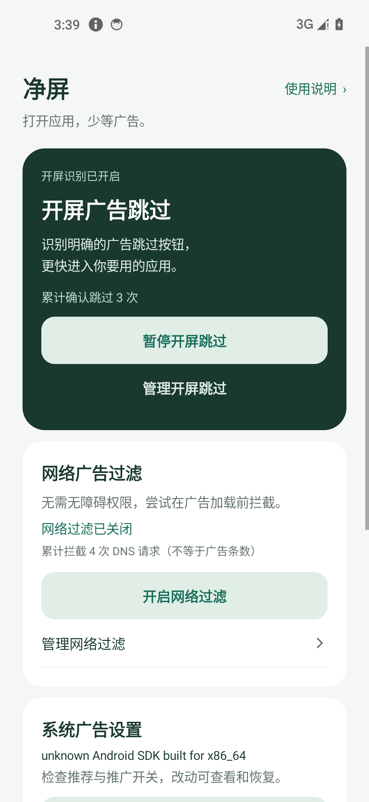
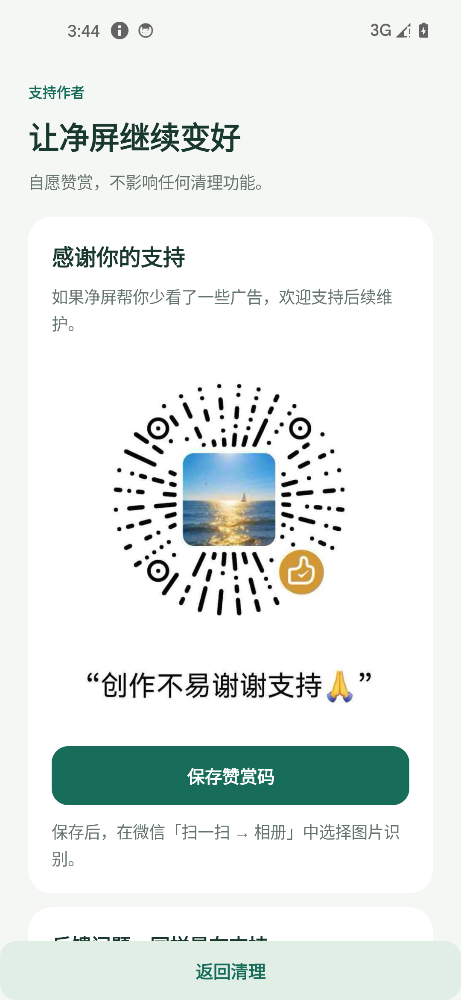

# 净屏 · 安卓广告清理工具

[下载 0.3.0 预览版 APK](https://github.com/jeagsdg/android-ad-cleaner-mobile/raw/refs/heads/main/dist/ClearScreen-0.3.0-preview.apk) · [验收记录](artifacts/验收记录.md) · [授权帮助](docs/权限兼容.md) · [机型适配](docs/机型适配.md) · [开源来源](NOTICE.md)

**预览版，国产厂商实机适配仍待验收。** 基于 [android-ad-cleaner](https://github.com/rddmwmddr/android-ad-cleaner) 的规则与保护逻辑，做成纯手机原生工具。无需电脑、Root 或 Shizuku；没有账号、广告 SDK 或付费模块。

0.3 增加独立的网络过滤和开屏跳过，改善延迟加载导致的清理漏项。不能承诺所有广告都能处理，也不能自行解除厂商的无障碍授权限制。

 

## 选择需要的功能

| 功能 | 怎么开启 | 能处理什么 |
|---|---|---|
| 开屏跳过 | 首页开启开屏跳过 → 开启无障碍 | 应用进入前台短时间内，可读取且明确的广告跳过按钮 |
| 网络过滤 | 首页开启网络过滤 → 系统 VPN 确认 | 本地规则中的完整广告域名，不依赖无障碍 |
| 设置清理 | 开始清理 → 开启无障碍 → 确认范围 | 已匹配的系统推荐、推广位、部分开屏开关；保存原值并回读 |

三项功能分别启停。设置清理完成后可以查看结果、重试未完成项，或在“改动记录与恢复”撤销。开屏跳过支持搜索并排除应用，也可从最近跳过记录直接排除。网络过滤支持查看最近拦截、放行域名、清除记录和停止。

营销通知检查可选：授权通知访问后发现已出现的渠道，再由用户发起清理。保留支付、订单、聊天、天气预警等重要服务，不关闭应用通知总开关。名称含糊或混合用途时跳过。

## OPPO 的授权卡点

已收到 Find X8 Pro / ColorOS 16.0 的真实系统截图：解除入口在 **应用详情 → 权限管理 → 右上角 ⋮ → 解除所有授权限制**。旧版显示“未请求任何权限”，导致权限管理灰显；用户反馈覆盖安装无效。

新版为网络过滤状态通知申请通知权限，并在帮助中提供入口。申请后可重新检查权限管理；**是否恢复 ColorOS 的解除入口仍需这台实机验证**，不能把通知授权等同于无障碍解锁。解除限制和无障碍开关都必须由用户在系统中确认。

若仍受限，可先使用独立网络过滤。不需要反复卸载或关闭整机防护。详见 [授权兼容](docs/权限兼容.md)。

## 覆盖与边界

- 75 组语义规则、112 条候选入口、139 个自动目标定义、9 个手动目标定义。覆盖小米 / Redmi / POCO、OPPO / 一加 / realme、vivo / iQOO、荣耀、魅族的已知设置路径。数量不是已清掉的广告数，也不是实机通过数。
- 设置页会等待稳定，首次未找到且未发生写入的可重试项最多自动补查一轮。成功项不重复改，结果不确定时停止并保留账本。
- 网络过滤内置 235,866 个完整广告域名，采用本地 DNS-only VPN；其他流量由原网络传输，不解密 HTTPS、不接入净屏服务器。与其他 VPN 互斥，统计是 DNS 请求数。
- 开屏跳过只识别有明确广告依据的控件，不盲点坐标、不把任意“关闭”当广告、不自动同意权限或隐私协议。看不到控件时保留原页面。
- 补充 21 条应用专属开屏控件规则（18 个应用）与 2 类广告 SDK 开屏资源名，可处理部分无文字按钮。哔哩哔哩、知乎、华为/荣耀应用市场等规则均有 MIT 开源出处；这些是候选覆盖，尚未逐个真实 App 验收。
- 缓存广告、同域名内容与广告、应用自带加密 DNS、视频内嵌/奖励广告可能无法处理。关闭个性化推荐也可能只改变推荐方式。
- Android 8.0（API 26）起可安装。Android 9 已开启加密 DNS 时暂不叠加过滤。原生鸿蒙不能运行此 APK。
- 通用开屏/网络能力不限制五款机型；华为兼容 Android 的系统、联想/摩托罗拉、中兴/努比亚等也可尝试，但不因此声称这些品牌系统设置已适配。Find X8 Pro、Magic8、GT Pro、小米 10 至尊、iQOO Neo9 均仍需厂商实机复验。
- 后台服务被系统结束后需重新开启；应用不会仅凭上次保存的状态显示“运行中”。网络异常时退出过滤并交还系统解析。

更多实现边界见 [网络过滤与开屏](docs/网络过滤与开屏.md)。上游脚本的真机结果不会自动继承到本 App。

## 支持作者

首页底部和使用说明中提供自愿赞赏入口。使用作者提供的原始图片，可以保存到相册；Android 8–9 使用系统文件保存窗口。赞赏不影响任何清理功能，不自动打开支付应用。图片显示与保存已检查，微信识别和实际收款未测试。

## 数据与恢复

不保存截图、输入内容或页面正文；通知检查只保留应用/渠道信息。DNS 查询按当前物理网络的设置解析，不静默切换公共 DNS。仅在本机保留最近 30 个被拦域名、最近 20 条跳过记录与累计统计，支持清除记录。诊断不包含域名历史、放行列表或通知正文。

改动账本在操作前同步写入；恢复时核对系统构建、目标应用版本与当前状态。升级可能改变路径，无法确认则保留手动说明。**卸载或清除应用数据会删除账本，请先恢复需要的设置或导出记录。** 记录导出不是系统备份。

反馈可使用 App 内诊断报告，包含系统构建、实际目标版本、失败原因和尝试入口。用户分享前可以查看文本并遮挡截图隐私。

## 验证

以 [验收记录](artifacts/验收记录.md) 的最终 APK 哈希和证据为准。协议单元测试、Robolectric 页面测试、隔离夹具和 AOSP Android 14 模拟器覆盖不同层面，不能替代国内厂商实机验收。

用户提供的李跳跳安装包已核对元信息，因 ARM64 库与本机 x86_64 模拟器不匹配，未完成实际 UI 对比；没有分发其安装包或复制受保护代码。

## 构建与复现

Java + 原生 Android View，无运行时第三方 SDK。JDK 17/21、Android SDK 35、Gradle 8.8、AGP 8.5.2。设置本地 SDK 路径后：

```text
./gradlew :app:testDebugUnitTest :app:lintDebug :app:assembleDebug
python tools/verify_sources.py
```

Windows 中文目录使用 `tools/build.ps1 -JavaHome <JDK路径>`。加 `-Release` 构建签名发布 APK；`-Offline -UseExistingCache` 只用于已有完整缓存。输出文件名随 app/build.gradle 的版本号生成。

发布密钥与配置不上传仓库。本地 `.local/signing.properties` 示例：

```properties
storeFile=../.local/release/clearscreen.jks
storePassword=自己的密码
keyAlias=clearscreen
keyPassword=自己的密码
```

升级必须沿用原签名。APK 校验见 [SHA256SUMS](dist/SHA256SUMS.txt)。

独立测试夹具与 instrumentation 不进入用户 APK。仅在可重置模拟器运行；原执行器测试会重连测试服务并改动夹具开关。网络套件需先在真实界面完成系统 VPN 授权：

```text
adb -s <模拟器> shell am instrument -w app.clearscreen.test/app.clearscreen.DeviceChecks
adb -s <模拟器> shell am instrument -w -e suite network app.clearscreen.test/app.clearscreen.DeviceChecks
```

测试 APK 必须与被测 APK 同签名；勿在个人日常手机运行 instrumentation。

规则维护：`tools/import_rules.py`、`tools/curate_routes.py`、`tools/verify_sources.py`、`tools/generate_parity_cases.py`；DNS 列表生成使用 `python tools/import_dns.py <已下载的固定源文件>`，会强制核验源哈希。开屏候选使用 `tools/import_splash.py`（开发环境需 json5），同样固定源文件哈希。这些工具不在手机执行上游 Python 脚本。

## 开源

代码 MIT。固定上游提交 `19bb74fbefece01763f713c3c26220f63659ed87` 的 37 份参考脚本和相关 helper 保留在 vendor 目录。DNS 列表使用 Unlicense 并保留来源、固定提交与校验信息。详见 [NOTICE](NOTICE.md)。
