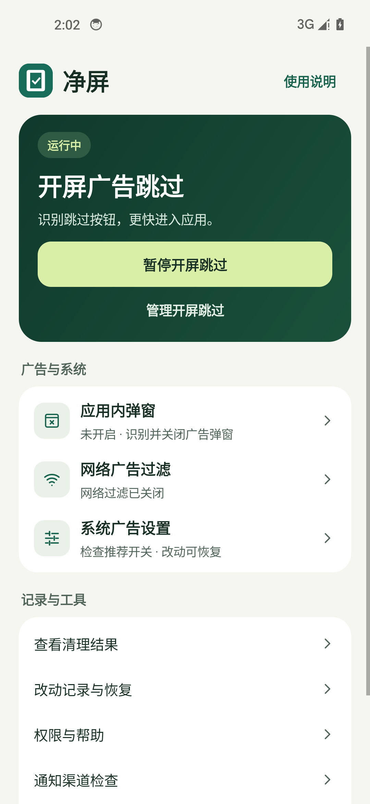
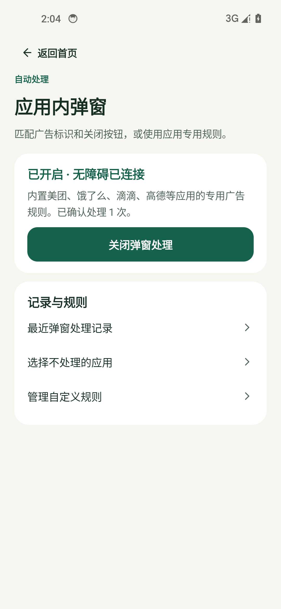
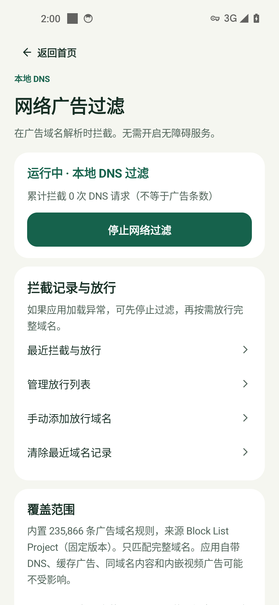

# 净屏 ClearScreen · 安卓广告清理

打开 App 时，净屏会尝试帮你点掉开屏广告的「跳过」。应用内弹窗和网络广告也能分开处理。想关掉系统推广时，可以先查看待清理项，改动有记录，支持恢复。

**[下载 0.8.1 签名预览版 APK](dist/ClearScreen-0.8.1-preview.apk?raw=true)** · [授权帮助](docs/权限兼容.md) · [机型适配](docs/机型适配.md) · [验收记录](artifacts/验收记录-v08.md)

支持 Android 8.0 及以上，无需 Root、Shizuku 或电脑。开屏和弹窗规则已内置，网络过滤通过本机 VPN 处理 DNS 请求。

<p>
  
  
  
</p>

界面预览来自隔离模拟器。

## 安装后怎么用

1. 安装上方签名 APK。同签名的旧版净屏可直接覆盖升级。
2. 在首页选需要的功能。开屏、弹窗和设置清理需要系统无障碍授权。网络过滤可单独开启，首次使用需要确认系统 VPN 请求。
3. 到对应功能的记录页核对处理结果。系统设置改动可从「改动记录与恢复」逐项还原。

**当前为预览版。** 开屏效果取决于广告样式、应用版本和系统能否读取相关控件。荣耀真机已验证 DNS 拦截、放行和系统管家单项读取。腾讯视频现场跳过、荣耀应用市场开屏和 ColorOS 受限授权仍待确认。[验证范围与已知问题](artifacts/验收记录-v08.md)

## 版本更新

### 0.8.1 荣耀真机复测与开屏修复

- 腾讯视频原生开屏支持仅响应触摸的「跳过」控件。冷启动仍需同一窗口的已核对广告标记。手势取消会记录为未确认。
- 批量设置清理会等待荣耀应用市场的已知开屏离开，再查找内容推荐菜单。稳定页面检测支持路由声明的精确控件 ID。

### 0.8 识别覆盖和清理结果

- 内置开屏目录包含 58 个应用的 68 条专用候选与 3 类 SDK 规则，覆盖本轮核对的荣耀应用市场、腾讯视频原生开屏以及酷狗音乐控件。通用识别仍可处理满足条件的其他 App。
- 批量清理保存完整任务清单和未完成原因。页面显示完成与未完成数量，重复滚动或单组超时后保留结果。荣耀系统管家支持已核对的新版组件跳转，旧版入口保留。
- ColorOS 权限帮助分开说明未授权、系统限制和服务未连接。对应系统设置由机主确认。[本轮验收与移植对照](artifacts/验收记录-v08.md)

<details>
<summary>查看 0.7 及更早版本</summary>

### 0.7 首页改版与可靠性修复

- 首页突出开屏跳过，应用内弹窗、网络广告过滤、系统广告设置独立进入。授权完成后返回发起页面，设置清理完成后打开结果页。自定义规则提供净屏格式备份和还原。
- 广告匹配检查按钮文字、无障碍描述和所在窗口。对广告标识只出现在无障碍描述里的弹窗也可匹配，延迟点击前复核窗口。
- 系统清理重试只处理选中的未完成开关，保留其它结果。恢复核对原应用和开关。网络过滤修复 TCP DNS 握手、重传计时和拦截记录清除时的竞争。

[新版首页](artifacts/emulator/v07-home-running.png) · [360dp／大字首页](artifacts/emulator/v07-home-360dp-font130.png) · [应用内弹窗](artifacts/emulator/v07-popup-enabled.png)

### 0.6 内置广告规则与关闭响应

- 开启「开屏广告跳过」和「应用内弹窗」后，内置规则自动工作。应用内目录包含 59 个应用的 73 条候选，另外内置同程、闲鱼和转转的 4 条优先规则。具体应用与待验证项见 [验收记录](artifacts/验收记录-v06.md)。
- 开屏和新窗口采用短等待与分段补查。当前台窗口切换时，新广告检查可提前调度。专用广告规则在点击前复查上下文，点击后核对目标是否仍然存在。
- 开屏按当前前台应用、排除项、明确跳过语义和控件位置识别。应用内广告还会核对页面、广告提示或控件关系。[实现参考](https://www.cnblogs.com/Cl0ud/p/17684204.html)

### 0.5 广告识别与兼容（历史版本）

- 开屏规则库包含 64 条应用专用候选，覆盖 56 个应用及 2 类广告 SDK 资源名。保留有依据的控件关系、页面约束和时限。相同置信度的多个目标同时出现时停止点击。
- 处理窗口事件早于可读控件树到达的情况。开屏跳过支持全角倒计时、简繁中文、英文、日文和韩文的一部分常见跳过文案。应用内弹窗可在同一面板核对广告标识和明确的关闭广告按钮。
- 当时的兼容规则导入会整组验证开屏关键词替换。当前版本通过内置规则覆盖主要场景，备份页只接受净屏格式。
- 前台保活区可检查系统后台限制和电池优化状态。兼容手势以控件所在屏幕为准，返回动作限于默认屏幕上的独立弹窗。

### 0.4 历史记录

从首页进入「管理开屏跳过」，可分别开启开屏跳过、应用内弹窗处理和微信／QQ 原图辅助。每个应用可以只排除开屏、只排除弹窗，或同时排除。已确认的操作可选择显示提示，开屏与弹窗的次数及最近记录分开统计。前台保活在无障碍已连接、有跳过功能开启且允许通知时可用，可从通知停止。

- 弹窗处理默认关闭。内置抖音和网易云音乐的更新提示候选。自定义弹窗规则核对同一面板中的提示与关闭控件，遇到多个不同目标或敏感提示时跳过。
- 「管理自定义规则」支持添加、编辑、删除、复制和分享。当前版本可粘贴还原净屏备份，预览后确认替换。
- 已有兼容规则支持开屏关键词追加或替换、文字包含与前后缀、控件 ID、实际节点的精确范围、延迟、有限搜索和连续弹窗。高级点击须匹配可见目标，返回动作限于可辨识的独立小窗口。[作者进阶指南](https://juejin.cn/post/6938590373740544007)
- 原图辅助按微信／QQ 及查看／选择原图分别启用。选择原图只勾选对应选项，发送由用户操作。

0.3 增加独立的网络过滤和开屏跳过，改善延迟加载导致的清理漏项。不能承诺所有广告都能处理，也不能自行解除厂商的无障碍授权限制。

</details>

## 选择需要的功能

| 功能 | 怎么开启 | 能处理什么 |
|---|---|---|
| 开屏跳过 | 首页开启开屏跳过 → 开启无障碍 | 应用进入前台短时间内，可读取且明确的广告跳过按钮 |
| 弹窗处理 | 首页应用内弹窗 → 开启弹窗处理 → 开启无障碍 | 内置候选或用户确认的规则明确匹配的弹窗 |
| 网络过滤 | 首页网络广告过滤 → 开启网络过滤 → 系统 VPN 确认 | 本地规则中的完整广告域名，不依赖无障碍 |
| 设置清理 | 首页系统广告设置 → 确认清理范围 | 已匹配的系统推荐、推广位、部分开屏开关；需要无障碍，保存原值并回读 |

各项功能分别启停。设置清理完成后可以查看结果、重试未完成项，或在「改动记录与恢复」撤销。开屏跳过支持搜索并排除应用，也可从最近跳过记录直接排除。网络过滤支持查看最近拦截、放行域名、清除记录和停止。

营销通知检查可选：授权通知访问后发现已出现的渠道，再由用户发起清理。保留支付、订单、聊天、天气预警等重要服务，不关闭应用通知总开关。名称含糊或混合用途时跳过。

## OPPO 的授权卡点

已收到 Find X8 Pro / ColorOS 16.0 的真实系统截图：解除入口在 **应用详情 → 权限管理 → 右上角 ⋮ → 解除所有授权限制**。旧版显示“未请求任何权限”，导致权限管理灰显；用户反馈覆盖安装无效。

新版为网络过滤状态通知申请通知权限，并在帮助中提供入口。申请后可重新检查权限管理；**是否恢复 ColorOS 的解除入口仍需这台实机验证**，不能把通知授权等同于无障碍解锁。解除限制和无障碍开关都必须由用户在系统中确认。

若仍受限，可先使用独立网络过滤。不需要反复卸载或关闭整机防护。详见 [授权兼容](docs/权限兼容.md)。

## 覆盖与边界

- 75 组语义规则、113 条候选入口、139 个自动目标定义、9 个手动目标定义。覆盖小米 / Redmi / POCO、OPPO / 一加 / realme、vivo / iQOO、荣耀、魅族的已知设置路径。数量不是已清掉的广告数，也不是实机通过数。
- 设置页会等待稳定，首次未找到且未发生写入的可重试项最多自动补查一轮。成功项不重复改，结果不确定时停止并保留账本。
- 网络过滤内置 235,866 个完整广告域名，采用本地 DNS-only VPN；其他流量由原网络传输，不解密 HTTPS、不接入净屏服务器。与其他 VPN 互斥，统计是 DNS 请求数。
- 默认开屏跳过只识别有明确广告依据的控件。主动导入的精确范围规则须命中真实可见控件。看不到控件时保留原页面。
- 68 条应用专属开屏候选规则（58 个应用）与 3 类广告 SDK 开屏规则，可处理部分无文字按钮。规则依据包括固定版本的 MIT 订阅和已核对的安装包，实际命中还取决于第三方 App 版本与广告样式。
- 缓存广告、同域名内容与广告、应用自带加密 DNS、视频内嵌/奖励广告可能无法处理。关闭个性化推荐也可能只改变推荐方式。
- Android 8.0（API 26）起可安装。Android 9 已开启加密 DNS 时暂不叠加过滤。原生鸿蒙不能运行此 APK。
- 通用开屏/网络能力不限制五款机型；华为兼容 Android 的系统、联想/摩托罗拉、中兴/努比亚等也可尝试，但不因此声称这些品牌系统设置已适配。Find X8 Pro、Magic8、GT Pro、小米 10 至尊、iQOO Neo9 均仍需厂商实机复验。
- 后台服务被系统结束后需重新开启；应用不会仅凭上次保存的状态显示“运行中”。网络异常时退出过滤并交还系统解析。

更多实现边界见 [网络过滤与开屏](docs/网络过滤与开屏.md)。上游脚本的真机结果不会自动继承到本 App。

## 支持作者

首页底部和使用说明中提供自愿赞赏入口。使用作者提供的原始图片，可以保存到相册；Android 8–9 使用系统文件保存窗口。赞赏不影响任何清理功能，不自动打开支付应用。图片显示与保存已检查，微信识别和实际收款未测试。

## 数据与恢复

规则保存用户输入或导入的选择条件，自动处理只记录应用、时间和确认结果。截图、输入内容和完整页面不会进入记录。通知检查只保留应用/渠道信息。DNS 查询按当前物理网络的设置解析。仅在本机保留最近 30 个被拦域名、最近各 20 条开屏和弹窗记录与累计统计，支持清除记录。诊断不包含域名历史、放行列表或通知正文。

改动账本在操作前同步写入；恢复时核对系统构建、目标应用版本与当前状态。升级可能改变路径，无法确认则保留手动说明。**卸载或清除应用数据会删除账本，请先恢复需要的设置或导出记录。** 记录导出不是系统备份。

反馈可使用 App 内诊断报告，包含系统构建、实际目标版本、失败原因和尝试入口。用户分享前可以查看文本并遮挡截图隐私。

## 验证

以 [0.8 验收记录](artifacts/验收记录-v08.md) 的 APK 哈希和测试证据为准。协议单元测试、Robolectric 页面测试与 Android 8.1、14、15 的隔离模拟器回归覆盖不同层面，厂商设备需单独实机验收。

用户提供的李跳跳安装包已核对元信息，因 ARM64 库与本机 x86_64 模拟器不匹配，未完成实际 UI 对比；没有分发其安装包或复制受保护代码。

## 构建与复现

Java + 原生 Android View，无运行时第三方 SDK。JDK 17/21、Android SDK 35、Gradle 8.8、AGP 8.5.2。设置本地 SDK 路径后：

```text
./gradlew :app:testDebugUnitTest :app:lintDebug :app:assembleDebug
python tools/verify_sources.py
```

Windows 中文目录使用 `tools/build.ps1 -JavaHome <JDK路径>`。加 `-Release` 构建签名发布 APK；`-Offline -UseExistingCache` 只用于已有完整缓存。输出文件名随 app/build.gradle 的版本号生成。

发布密钥与配置不上传仓库。本地 `.local/signing.properties` 示例：

```properties
storeFile=../.local/release/clearscreen.jks
storePassword=自己的密码
keyAlias=clearscreen
keyPassword=自己的密码
```

升级必须沿用原签名。APK 校验见 [SHA256SUMS](dist/SHA256SUMS.txt)。

独立测试夹具与 instrumentation 不进入用户 APK。仅在可重置模拟器运行；原执行器测试会重连测试服务并改动夹具开关。网络套件需先在真实界面完成系统 VPN 授权：

```text
adb -s <模拟器> shell am instrument -w app.clearscreen.test/app.clearscreen.DeviceChecks
adb -s <模拟器> shell am instrument -w -e suite network app.clearscreen.test/app.clearscreen.DeviceChecks
```

测试 APK 必须与被测 APK 同签名；勿在个人日常手机运行 instrumentation。

规则维护：`tools/import_rules.py`、`tools/curate_routes.py`、`tools/verify_sources.py`、`tools/generate_parity_cases.py`；DNS 列表生成使用 `python tools/import_dns.py <已下载的固定源文件>`，会强制核验源哈希。开屏候选使用 `tools/import_splash.py`（开发环境需 json5），同样固定源文件哈希。这些工具不在手机执行上游 Python 脚本。

## 开源

代码 MIT。固定上游提交 `19bb74fbefece01763f713c3c26220f63659ed87` 的 37 份参考脚本和相关 helper 保留在 vendor 目录。DNS 列表使用 Unlicense 并保留来源、固定提交与校验信息。详见 [NOTICE](NOTICE.md)。
