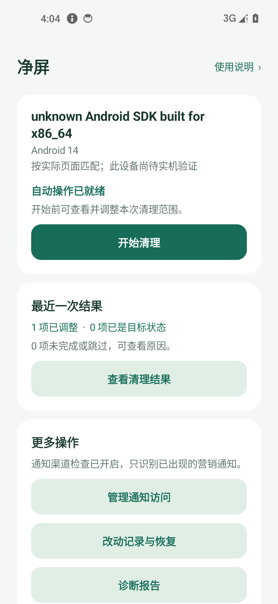
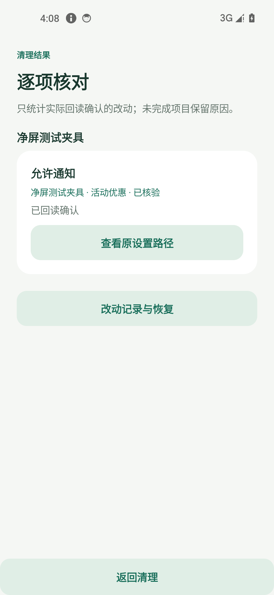

# 净屏 · 安卓广告设置清理工具

[下载安装包](https://github.com/jeagsdg/android-ad-cleaner-mobile/raw/refs/heads/main/dist/ClearScreen-0.2.0-preview.apk) · [验收记录](artifacts/验收记录.md) · [五款重点机型](docs/机型适配.md) · [开源来源](NOTICE.md)

**0.2.0 预览版／厂商实机适配待验收。** 基于 [android-ad-cleaner](https://github.com/rddmwmddr/android-ad-cleaner) 改写为纯手机原生工具，使用时无需电脑、Root 或 Shizuku。重点补充 Find X8 Pro、Magic8、GT Pro、小米 10 至尊、iQOO Neo9 所属系统家族的入口差异；型号识别与规则候选不等于实机通过。当前用于小范围兼容性验证，不能宣传为全品牌、全系统、全部广告已清除。

 

上图来自实际发布包的模拟器操作；测试夹具只用于验证清理和恢复流程。

## 怎么用

1. 安装 APK，打开净屏，点击 **开始清理**。
2. 首次按引导开启「净屏」无障碍服务，再返回 App。此权限用于读取设置页和点击已确认的开关。
3. 确认清理范围，保持亮屏，等待自动检查、修改和回读。运行时底部有 **停止** 按钮。
4. 结束后查看分组结果，可筛选并重试未完成项。需要撤销时进入 **改动记录与恢复**，支持逐项或批量恢复。
5. 无法自动处理的网页或自绘开关提供中文手动说明；遇到问题可复制或保存 **诊断报告**，其中包含具体构建版本和尝试过的入口。

营销通知清理可选：点击「开启通知渠道检查」授权通知访问；营销通知出现后，再开始清理。只处理明确的营销渠道，保留订单、支付、聊天、天气预警等重要渠道。不记录通知正文。

Android 13 及以上通过文件安装时，部分设备会限制开启无障碍或通知访问。系统提示受限设置时，可到「设置 → 应用 → 净屏 → 更多 → 允许受限制的设置」再开启权限；具体入口因厂商不同。[Android 官方说明](https://support.google.com/android/answer/12623953?hl=zh-Hans)。授权需要机主确认，App 不能自行开启。

Android 8.0（API 26）及以上可安装；实际端到端验证在 Android 14 AOSP 模拟器完成，其他 Android 版本和厂商系统尚未完成实机验证。原生鸿蒙不支持此 APK。

## 做了什么

- **75 组规则、106 条入口、140 个自动目标定义**，另有 9 个手动目标定义：涉及小米 / Redmi / POCO、OPPO / 一加 / realme、vivo / iQOO、荣耀、魅族，按品牌及已安装包匹配。这些是候选覆盖数量，不是手机上的广告数量或已验证成功数量。
- 覆盖有明确开关的系统推荐、搜索热词、商店推广位、浏览器推荐及部分开屏广告设置；另可发现和处理本机出现过的营销通知渠道。
- 先只读检查候选路径，直达入口不允许访问时尝试已知菜单；精确匹配页面文字、同义名称和唯一开关。跨包跳转限定到具体步骤；同名、灰态、锁屏、错误前台、协议弹窗或不确定结果会跳过或停止。
- 改动前同步保存原值；改动后两次回读确认；反向保护开关（例如「限制广告跟踪」）正确开启。重复执行不来回切换。
- 保存实际走通的入口及相关应用版本，恢复时核对原始状态；旧版账本可读取。提供批量恢复、未完成项重试、可读诊断报告与 JSON 导出。没有账号、付费模块、广告 SDK 或网络权限。
- 单页主流程，次级入口提供结果、恢复、权限与适配说明。

不是网络广告过滤器：没有 VPN / DNS 拦截、第三方 App 通用开屏跳过、视频插播拦截、广告组件挂起或快应用处理。关闭「个性化推荐」可能只减少定向推荐，不代表广告全部消失。

普通 App 无法枚举其他 App 的全部通知渠道。本工具仅发现授权后出现或授权时仍有效的通知；关闭前必须核对应用名与渠道名，不能确认就跳过，不改应用通知总开关。名称含糊或混用服务通知的渠道不自动关闭。

恢复依赖原页面仍可访问；系统或应用升级可能改变路径。卸载或清除净屏数据会删除账本，**请先完成需要的恢复或导出**。导出是操作记录，不是系统备份。

## 验证与反馈

实际结果见 [验收记录](artifacts/验收记录.md)。Android 模拟器内的独立测试应用仅用于验证执行器，不冒充厂商应用验证。上游 Python 脚本的真机结果也不会自动继承到手机端。

反馈优先提供 App 内的诊断报告，它记录品牌型号、Android 与构建标识、规则目标应用版本、失败原因、已尝试入口和恢复状态。报告不包含通知正文、账号、设备序列号或完整已安装应用清单；构建标识用于识别系统版本，分享前仍可自行查看。厂商显示的系统版本名称可另行补充。截图请遮住账号、通知正文等私人内容。先在小范围核对清理结果并验证恢复，再扩大分发。

## 开发与复现

Java + 原生 Android View，无运行时第三方依赖。JDK 17/21、Android SDK 35、Build Tools 34.0.0、Gradle 8.8、AGP 8.5.2。设置 `local.properties` 的 `sdk.dir`，然后：

```text
./gradlew :app:testDebugUnitTest :app:lintDebug :app:assembleDebug
```

Windows 中文目录可用 `./tools/build.ps1 -JavaHome <JDK路径>`。脚本创建临时目录联接以兼容 Gradle 测试进程，不移动源码；`-Offline -UseExistingCache` 仅用于已有完整缓存的环境。调试构建输出 `dist/ClearScreen-0.2.0-debug.apk`。

发布 APK 使用独立发布密钥签名，`debuggable=false`。构建发布包需在本地创建 `.local/signing.properties`：

```properties
storeFile=../.local/release/clearscreen.jks
storePassword=自己的密码
keyAlias=clearscreen
keyPassword=自己的密码
```

然后运行 `./tools/build.ps1 -JavaHome <JDK路径> -Release`。私钥和配置不上传仓库；维护者应保管原密钥，否则新签名 APK 无法直接覆盖旧版安装。签名和 SHA-256 信息见 [安装包校验](dist/SHA256SUMS.txt)。

设备测试使用独立 `fixture` 模块和 `app/src/androidTest`，均不打包进分发 APK。仅在可重置的测试模拟器执行：构建并安装三个 debug APK，随后 `adb -s <测试设备> shell am instrument -w app.clearscreen.test/app.clearscreen.DeviceChecks`。测试会重连测试无障碍服务、修改测试夹具开关并验证恢复，勿在个人日常手机运行此 instrumentation。

`python tools/import_rules.py` 再生成上游词表与来源索引；`python tools/curate_routes.py` 在仓库内的基础规则上应用手机端候选入口与精确别名，之后运行 `python tools/verify_sources.py` 核验目标出处；`python tools/generate_parity_cases.py` 再生成分类对拍数据。这些工具不执行厂商清理脚本。

## 开源

MIT。固定上游提交 `b437125829b7e78589850f6a0e54f865d25a8e08` 的 36 份参考脚本和相关 helper 保留在 `vendor/android-ad-cleaner/`。每条手机端规则注明来源。详见 [NOTICE](NOTICE.md) 和 [LICENSE](LICENSE)。
